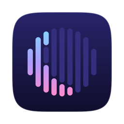
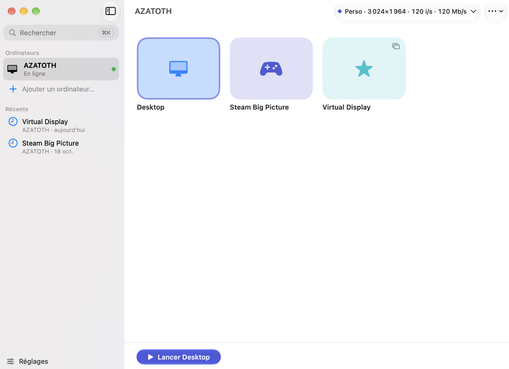

<div align="center">



# Moonvibe

**Stream games from your PC, built for the Mac.**

A fork of [Moonlight](https://github.com/moonlight-stream/moonlight-qt) with a native SwiftUI interface<br>
and settings tuned for macOS.

[](https://github.com/ciremek/moonvibe/releases/latest)


[](LICENSE)

### [⬇︎ Download Moonvibe](https://github.com/ciremek/moonvibe/releases/latest)

</div>



## What Moonvibe adds to Moonlight

Everything Moonlight does is still there (HEVC and AV1, HDR, 7.1 audio, gamepads…). On top of it:

### 🖥️ A real Mac app
- **SwiftUI interface with Liquid Glass**: a Home window with your PCs and their apps, guided pairing with the PIN, and a full settings window.
- **In-stream panels**: a bar with the PC and the app, a live stats card, and a shortcut reminder while the mouse is captured.
- **Quality presets** Fluide (smooth), Équilibré (balanced), Max and Perso (custom), matched to your display's resolution and refresh rate.
- **Keyboard shortcuts**: <kbd>⌘K</kbd> to search, <kbd>⌘1</kbd> to <kbd>⌘3</kbd> to launch the first apps, <kbd>⌘,</kbd> for settings.
- **In English and French**, following your Mac's language. Light and dark appearances, VoiceOver labels.
- **Runs alongside the official Moonlight**: separate settings, paired PCs and icon.

### 🎛️ Settings per PC and per app
- **Right-click a PC** to rename it, see the addresses Moonvibe detected, and add as many of your own as you like (Tailscale, WireGuard, a DDNS name…). A quick test checks that the right PC answers, and one pairing covers every address.
- **Right-click an app** to give its tile an icon and a color, and to give it its own quality: a lighter bitrate for a competitive game, say.
- **Open Mac apps with a stream**: Discord, a USB-over-IP server like VirtualHere… They open in the background when the stream starts and quit when it ends, if Moonvibe opened them.

### ⚡ Wake & Go
- Launch an app on a PC that's off or asleep: Moonvibe **wakes it up**, waits for it to answer, then **launches the app on its own**.
- The Wake-on-LAN packet goes out again every 10 seconds for 2 minutes, since Wi-Fi can drop it.
- **Wake options in the PC settings**: an editable MAC address, and an external target (IP or DDNS name + port) to wake the PC from outside your home network.

### 📡 Networking
- **LAN at home, VPN on the go**, with nothing to switch: as soon as your Mac is on the PC's network, Moonvibe uses its local address, and your Tailscale or WireGuard address elsewhere.
- **AWDL off while streaming** (optional): AirDrop, AirPlay and friends stop causing Wi-Fi latency spikes. It asks for admin approval once.
- **Auto resolution**: the stream uses the native resolution of the display it opens on.
- **Connection test** in the PC settings: latency, variation and loss, and the Wi-Fi band or Ethernet link this Mac uses.

### 🛟 Reliability
- If the PC falls asleep during a stream, it shows as **offline** as soon as you quit, and Moonvibe offers to wake it.
- Home comes back **right away** after a stream, even when the PC stopped answering.
- **Tells you when a new version is out**, with a link in the sidebar.
- Discord status off by default, private logs in `~/Library/Logs/Moonvibe`.

## Install

**You need** an Apple Silicon Mac on macOS 14.4 or later (Liquid Glass on macOS 26), and a PC running [Sunshine](https://github.com/LizardByte/Sunshine) or [Apollo](https://github.com/ClassicOldSong/Apollo).

1. Download `Moonvibe-x.y.z.dmg` from the [latest release](https://github.com/ciremek/moonvibe/releases/latest).
2. Open the DMG and drag **Moonvibe** to **Applications**.
3. On first launch, macOS blocks Moonvibe because it isn't signed by an identified Apple developer. Open **System Settings → Privacy & Security** and click **Open Anyway** next to Moonvibe. You only do this once.

<details>
<summary>Or with one Terminal command</summary>

```bash
xattr -dr com.apple.quarantine /Applications/Moonvibe.app
```

</details>

## While streaming

| Shortcut | Action |
| --- | --- |
| <kbd>⌃⌥⇧Q</kbd> | Quit the stream |
| <kbd>⌃⌥⇧S</kbd> | Show or hide stats |
| <kbd>⌃⌥⇧Z</kbd> | Release the mouse |

## Build Moonvibe

You need Xcode and Qt 6 from Homebrew (`brew install qt`).

```bash
git clone --recursive -b moonvibe https://github.com/ciremek/moonvibe.git
cd moonvibe
python3 setup-deps.py           # FFmpeg, SDL and friends, prebuilt by Moonlight
./build-mac.sh                  # build/app/Moonvibe.app
./scripts/package-moonvibe.sh   # build/release/Moonvibe-x.y.z.dmg
```

## Versions

See the [changelog](CHANGELOG.md) for what changed in each version.

## Credits and license

Moonvibe is a fork of [Moonlight PC](https://github.com/moonlight-stream/moonlight-qt), the open source client for NVIDIA GameStream and Sunshine. The whole streaming engine comes from the Moonlight team: thank you.

Like Moonlight, Moonvibe is released under the [GPLv3 license](LICENSE). It is neither affiliated with nor endorsed by the Moonlight project: for a problem with Moonvibe, open an issue here, not on their side.
